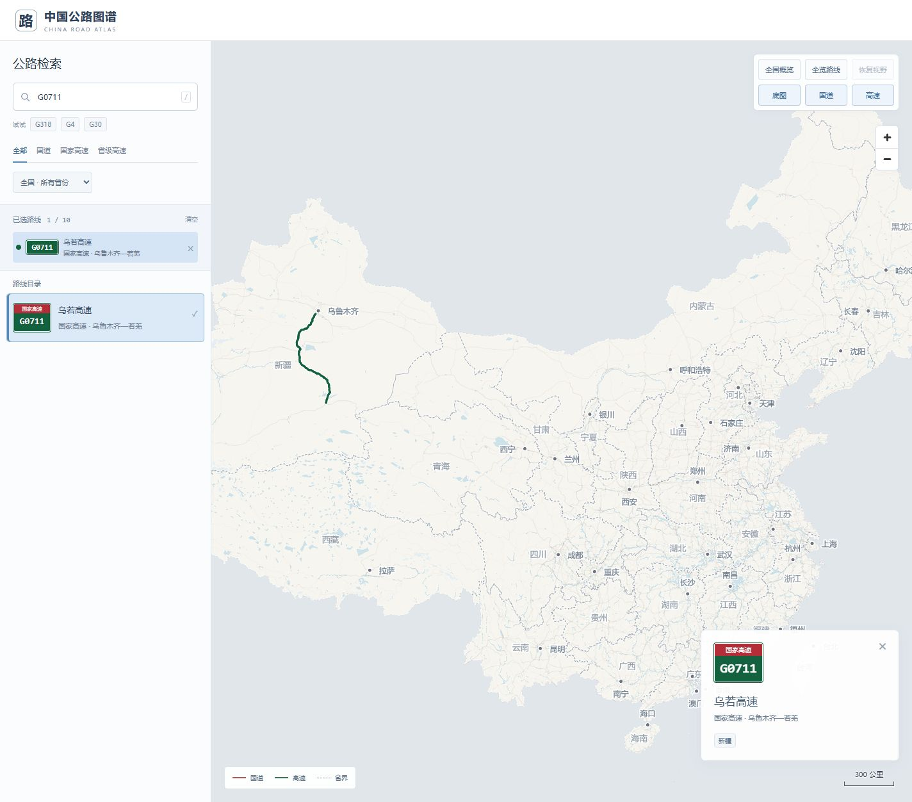

# 中国公路图谱 · China Road Atlas

沿着编号，读懂中国。搜索国道、国家高速与省级高速，查看道路走向，最多十条路线同屏对比。

**在线体验：[ydl66.top/map/](https://ydl66.top/map/)** · 当前稳定版：**v1.0.4**

运行时使用本地矢量地图与道路文件，不依赖在线地图 API、CDN、在线字体或外部遥测。本机服务可以离线运行，公开部署时浏览器从自己的服务器按需读取展示数据。

> 仓库仅发布源码、文档、预览和验证记录。整个 `data/` 目录已被 `.gitignore` 排除，不提供地图数据包或运行镜像下载。**只克隆源码不能直接显示地图**，须自行准备数据，或从已有本地归档恢复。

## 预览



| 手机地图 | 全屏路线列表 |
| --- | --- |
|  |  |

## 功能

- 按编号、名称、别名搜索，如 `G318`、`318国道`、`京港澳`、`西丽高速`，支持类别与途经省份筛选。
- 省级高速以省份与编号区分，避免同号混合。主标题为常用道路名称，副标题为类别与起终点；无可靠起终点时显示省份。
- 最多十条路线同屏显示，地图与列表再次点击可取消，已选区域可切换详情或单独移除。
- 搜索与选路保持中心及比例尺；“全国概览”“全览路线”暂存视野，“恢复视野”返回第一次概览前的视野。
- 最粗比例尺为 300 公里。国道红色、高速绿色、省界灰色虚线；选路后淡化其他编号道路，省界和地名不受影响。
- 手机默认露出底部搜索框，上拉把手或点击搜索框展开全屏列表，下拉或点击“返回地图”收起。选路返回地图，详情为紧凑底栏，顶部六个操作横向排列。
- 地名、道路与建筑按比例尺分层显示。悬停预加载、点击优先、加载动画与失败重试。
- `/` 聚焦搜索，`Esc` 优先收起手机列表，否则关闭详情。

## 架构与性能

前端为原生 HTML / CSS / JavaScript 和本地 MapLibre GL JS，没有前端构建依赖。生产后端为 Rust / Axum，SQLite 只读空间索引提供视野路网，MBTiles 提供底图。Python 标准库服务用于本机浏览和数据核对。

原始坐标与展示副本分开保存。路线远景、中景和近景简化阈值分别为 200m、10m、0.4m，保留独立线段，不跨缺口连线。z<=11 的底图使用精简副本，近景读取原始底图，原生瓦片至 z14，可继续放大至 z18。

路线最多并行请求 2 个，缓存 12 条 / 8MiB 文本体积估算；底图最多并行请求 3 个，缓存 12MiB / 160 块。视野查询约 450ms 防抖，取消过时请求。提前 gzip 压缩，版本化地图数据缓存 30 天。

生产镜像以 `scratch` 为基础，包含静态 Rust 程序与网页，约 5.22MB。容器非 root 运行、根文件系统与数据只读，内存限制 256MiB、CPU 限制 1.25 核。镜像在本机 WSL 编译，服务器只导入运行。

详细部署见 [deploy/README.md](deploy/README.md)，稳定版记录见 [docs/ARCHIVE-v1.0.4.md](docs/ARCHIVE-v1.0.4.md)。

## 启动与数据准备

已有完整 `data/` 时，使用 Python 3.10+：

```powershell
python server.py --open
```

Windows 也可双击 `start-map.cmd`。默认监听 `http://127.0.0.1:8766/`，端口占用时尝试后续端口。仅绑定本机，服务须保持运行。

首次准备数据需要联网和较多磁盘、内存，应用启动不会自动下载数据：

```powershell
python -m venv .prepare-venv --system-site-packages
.\.prepare-venv\Scripts\python.exe -m pip install -r requirements-prepare.txt -r requirements-basemap.txt
.\.prepare-venv\Scripts\python.exe scripts/download_data.py
.\.prepare-venv\Scripts\python.exe scripts/prepare_data.py
.\.prepare-venv\Scripts\python.exe scripts/download_basemap.py
.\.prepare-venv\Scripts\python.exe scripts/build_basemap.py
.\.prepare-venv\Scripts\python.exe scripts/prepare_city_labels.py
python scripts/build_network_index.py
.\.prepare-venv\Scripts\python.exe scripts/build_display_data.py
python scripts/precompress.py data
```

准备依赖与 Rust 依赖须提前安装。停止服务后再替换数据库；更新展示文件时同步修改前端 `DISPLAY_VERSION`，避免旧缓存。

## 文件与验证

`web/` 为网页，`backend/` 为 Rust 后端，`deploy/` 为镜像与代理配置，`scripts/` 为数据准备工具，`tests/` 为验证，`docs/` 为说明与预览。未跟踪的 `data/` 保存目录、边界、城市、路线、空间索引、底图、展示副本、原始资料与复核依据。

```powershell
node --check web/app.js
node --check web/mobile-drawer.js
node --test tests/test_view_controls.cjs tests/test_resource_paths.cjs tests/test_route_loader.cjs tests/test_tile_loader.cjs
.\.prepare-venv\Scripts\python.exe tests/test_display_data.py
wsl -d Ubuntu-22.04 -- env PATH=/home/ydl/.cargo/bin:/usr/bin:/bin CARGO_TARGET_DIR=/home/ydl/map-build/target cargo test --locked --manifest-path /mnt/e/projects/map/backend/Cargo.toml
python tests/verify_rust_server.py --base https://ydl66.top/map/ --public
```

手机浏览器尺寸检查包括 320×568、390×844 和 844×390，覆盖抽屉手势、搜索、选路返回、比例尺与溢出；桌面检查包括 1280 像素宽。尺寸检查不能替代全部真实设备测试。

## 数据范围与保护

国家目录基于《国家公路网规划（2022年）》，省级高速来自 OSM 已识别编号。实际道路按标签、路线关系提取并裁剪，存疑路段另存复核证据。自动筛查不等于官方逐段认证。

规划不代表已通车，部分路段不代表全线连续；缺口不会用直线补齐。省级高速尚未证实全量覆盖，2022年目录不能代表此后全部编号调整。行政轮廓与近似坐标转换不能用于精密边界测量。本项目用于道路浏览，不提供导航和通行状态认证。

当前本地快照含 1,579 个编号，1,377 个有展示走向。统计随重建变化，详情保存在本地 `data/report.json`。

公开服务仅提供必要目录、底图与展示数据，禁止直接下载原始数据库、原始路线、内部报告及原始资料，并使用 Nginx 限流。浏览器可绘制的公开坐标仍能被提取；这些措施增加抓取成本，不保证无法复制。

## 来源与许可

- 道路线位与 Shortbread 底图：© OpenStreetMap contributors，ODbL 1.0；来源为 Geofabrik 中国和台湾数据。
- 国家目录：国家发展改革委、交通运输部《国家公路网规划（2022年）》。
- 行政轮廓：阿里云 DataV 公开地理资源，保留原条款。
- MapLibre GL JS 5.24.0：BSD-3-Clause，详见 [MapLibre 许可证](web/vendor/maplibre-LICENSE.txt)。

第三方内容保留原许可。自有代码尚未单独指定开源许可证，公开源码不等同于授予额外使用许可。
